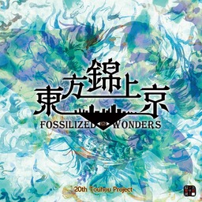

## Touhou 20 — 1.00a-r1 (first release)

A Nintendo Switch port of Touhou 20: Fossilized Wonders v1.00a, built on the TH20 C++ runtime from [eagler-touhou](https://github.com/Ritosa2333/eagler-touhou) (Ritosa2333).

* 🖥 **Resolution:** menus, portraits, dialogue and the HUD at 1280×960 (2x), the playfield at 640×480 (1x). Runs at full speed on stock clocks.
* 🎮 Remappable controls through Option → Key Config (defaults match the other ports).
* 🔊 BGM streamed straight from `thbgm.dat` with the original loop points.
* 👆 Touch controls in handheld mode.
* 📁 Recommended folder: `sd:/switch/touhou/touhou20/`, next to the other ports.

Put `touhou20.nro`, `th20.dat`, `thbgm.dat` and `msgothic.ttc` (ver 1.00a) in the folder and launch from hbmenu. If it runs out of memory from the album, start hbmenu by holding **R** while launching a game.

Optional: an empty file named `hires` (no extension) next to `th20.dat` draws everything at 2x (sharper, can slow down in the heaviest effects); `lowres` draws everything at 1x.

Controls: B shoot/confirm, A bomb/cancel, L/ZL focus, R/ZR skip dialogue, + pause, − snapshot; rebindable in Option → Key Config.
